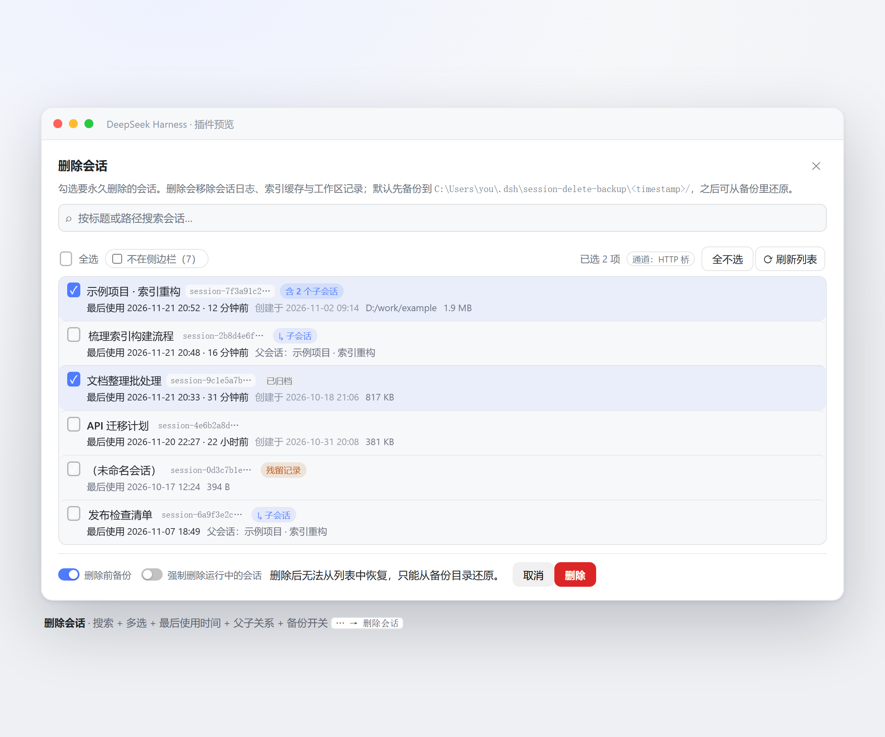
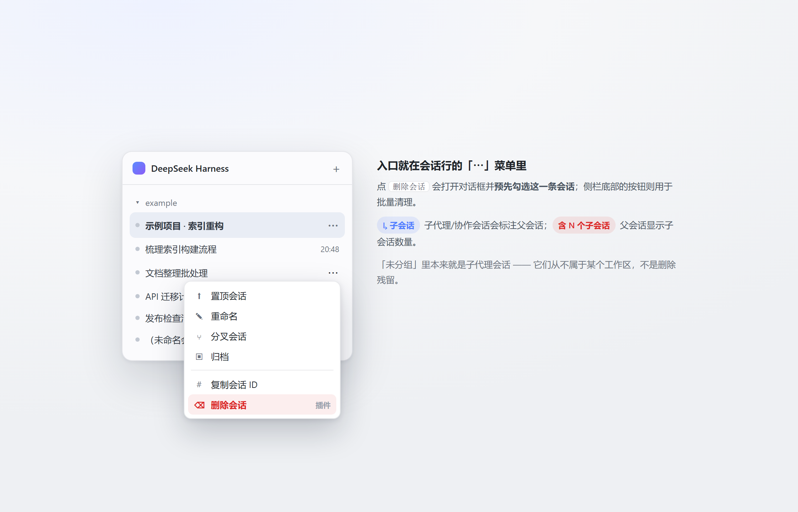
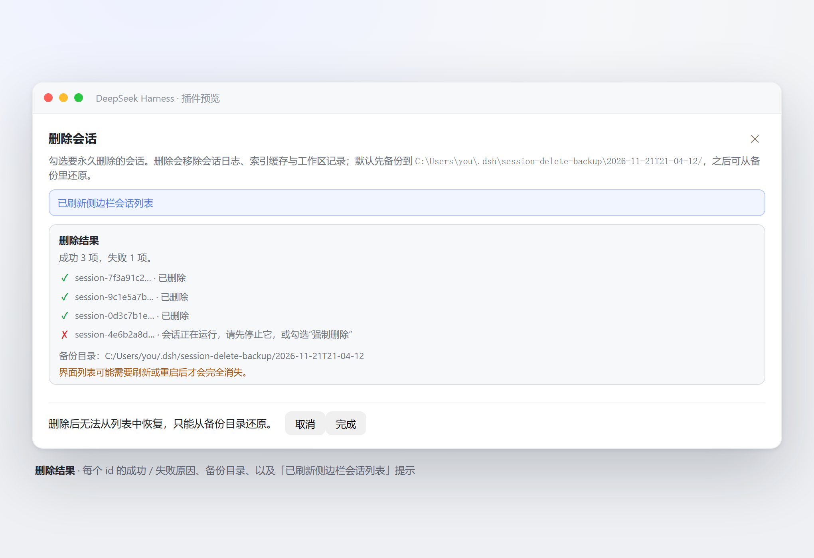
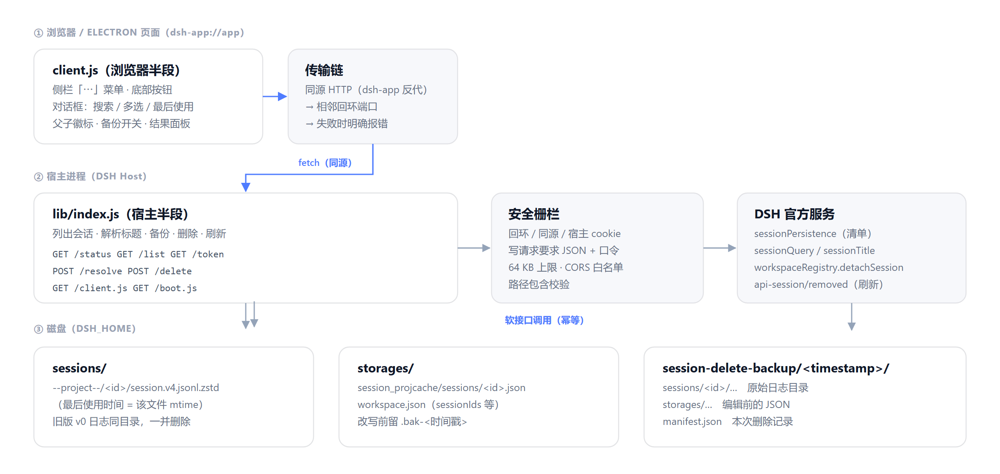

<div align="center">


# dsh-session-manager

**在 DeepSeek Harness 里真正删除聊天会话。**
搜索 · 多选 · 按会话 ID 删除 · 默认先备份 · 删完自动刷新列表

[](https://github.com/shuixing14/dsh-session-manager/releases)
[](LICENSE)
[](verify/)
[](package.json)
[](#-兼容性)
[](https://github.com/shuixing14/dsh-session-manager/stargazers)
[](https://shuixing14.github.io/dsh-session-manager/)
[](https://shuixing14.github.io/dsh-session-manager/plugin-index.json)

[部署命令](#-部署到自己的-dsh) · [插件库发布](PUBLISHING.md) · [在线主页](https://shuixing14.github.io/dsh-session-manager/) · [功能](#-功能) · [界面](#-界面) · [安全模型](#-安全模型) · [常见问题](#-常见问题) · [开发](#-开发) · [English](#english)

</div>

---



## 为什么需要它

DeepSeek Harness 目前**没有**删除会话的能力：

| 现有能力 | 实际行为 |
| :--- | :--- |
| `sessionPersistence` | 只有 `create` / `open` / `flush` / `stat` / `list` —— 没有 `delete` |
| `workspaceRegistry.delete()` | 只删「工作区登记」，并**显式保留**会话日志 |
| 归档（archive） | 只是可逆的隐藏，文件仍在磁盘上 |

本插件补上这一块，并且**默认先备份再删除**：删除前把会话目录、投影缓存与两个存储单位文件
复制到备份目录，备份失败则中止删除（fail-closed）。

## ✨ 功能

- **两个入口** —— 会话行右侧 **「⋯」菜单 → 删除会话**（自动勾选这一条），或侧栏底部 **「删除会话」** 按钮批量清理。
- **按会话 ID 删除** —— 列表就是真实会话 id 的投影；也能直接粘贴 id（逗号 / 空格 / 换行分隔多个）。
- **准确的时间** —— 每行显示 **最后使用**（会话日志最后写入时间）与 **创建于**，本地绝对时间、悬停精确到秒，
  按最后使用排序。
- **父子关系一眼可辨** —— 父会话「含 N 个子会话」，子会话「↳ 子会话 · 父会话：…」，父行紧跟子行。
- **与侧边栏一致** —— 默认只列侧边栏里的会话；「不在侧边栏（N）」开关可展开子会话 / 孤立记录。
- **删除前备份** —— 复制会话目录、投影缓存文档、`workspace.json` / `session_projcache.json`，并写 `manifest.json`。
- **删完自动刷新** —— 宿主经官方 `Workspace.detachSession()` 摘除工作区引用并广播 `api-session/removed`，
  前端再 `sessions.refresh()`，侧边栏**不需要重启**就少一行。
- **安全守卫** —— 当前会话、其子会话、运行中的会话（需显式「强制删除」）不可选；非法 id 只报单条错误。

## 🚀 部署到自己的 DSH

四种方式任选其一，装完 **刷新一次页面**（前端模块在页面加载时注入），侧栏即出现入口。

### ① DSH 插件管理器（bundle，推荐）

在 Harness 会话里让 Agent 执行（对整个 profile 生效）：

```
plugin_manager install_bundle  target: <本仓库目录的绝对路径>
```

> ⚠️ 尖括号里的内容**必须替换成你自己的真实路径**（例如 `D:\dsh\dsh-session-manager`）。
> 直接照抄占位符会得到一个指向不存在目录的依赖，插件会显示「异常 / 包不可用」。

### ② Release tarball

```bash
# 从 Releases 下载 dsh-session-manager-<version>.tgz
dsh plugin --profile desktop add ./dsh-session-manager-0.2.0.tgz
```

### ③ 本地开发（link）

```bash
# 把 <本仓库绝对路径> 换成真实路径，例如 D:\dsh\dsh-session-manager
dsh plugin --profile desktop add link:<本仓库绝对路径>
```

### ④ 手工挂载

在 profile 的 `package.json` 依赖里加入本包（`link:` 或版本号），并在 profile 的
`cordis.patch.yml` 中加入：

```yaml
- insert:
    - id: dsh-session-manager
      name: dsh-session-manager
```

### 校验 / 启用 / 卸载

```bash
# 探活（端口以运行时为准）
curl http://127.0.0.1:<port>/dsh-session-manager/status

plugin_manager set_bundle  target: dsh-session-manager  enabled: true   # 启用
plugin_manager set_bundle  target: dsh-session-manager  enabled: false  # 停用
dsh plugin --profile desktop remove dsh-session-manager                 # 卸载
```

## 🧩 DSH 插件库（market index）

本仓库同时托管一份符合 DSH `format: 1` 的**插件库索引**，可直接添加为 DSH 的索引源：

```text
https://shuixing14.github.io/dsh-session-manager/plugin-index.json
```

添加方式（任选）：

1. **DSH 设置 → 插件市场（Discover）→ 添加索引源**，粘贴上面的 URL；
2. 在 profile 的 patch 里给 `plugin-market` 行配置：

```yaml
- id: plugin-market
  config:
    indexes:
      - https://shuixing14.github.io/dsh-session-manager/plugin-index.json
```

之后在「Discover」页即可看到本插件并一键安装。索引的字段规则、托管方式、
npm / git 源写法、每次发版的完整流程见 **[PUBLISHING.md](PUBLISHING.md)**。

在线主页（GitHub Pages）：<https://shuixing14.github.io/dsh-session-manager/>

## 🖱 界面

<table>
  <tr>
    <td width="50%"></td>
    <td width="50%"></td>
  </tr>
  <tr>
    <td align="center"><sub>入口在会话行的「⋯」菜单里，打开即预选该会话</sub></td>
    <td align="center"><sub>结果面板：逐条成功/失败、备份目录、刷新提示</sub></td>
  </tr>
</table>

## 🧭 使用

1. 打开会话行右侧 **「⋯」→ 删除会话**（或侧栏底部 **「删除会话」**）。
2. 默认只显示侧边栏里的会话；需要清理子会话 / 孤立记录时勾选 **「不在侧边栏（N）」**。
3. 搜索标题、路径、会话 id 或时间，或直接粘贴 id；勾选要删的会话。
4. 点 **删除**（默认勾选「删除前备份」）。
5. 结果面板给出每个 id 的结果与备份路径；侧边栏会同步刷新。

### 从备份还原

```
<DSH_HOME>/session-delete-backup/<timestamp>/
├─ manifest.json                     # 本次删除的 id、结果、时间、home
├─ sessions/<session-id>/…           # 原始会话日志目录
└─ storages/
   ├─ workspace.json.bak             # 编辑前的整份文件
   ├─ session_projcache.json.bak     # 若存在
   └─ session_projcache/<id>.json    # 投影缓存文档
```

把 `sessions/<session-id>` 拷回 `<DSH_HOME>/sessions/<项目目录>/` 即可恢复会话本体；
必要时把 `storages/*.bak` 覆盖回 `~/.dsh/storages/` 下对应文件。

## 🔐 安全模型

| 机制 | 说明 |
| :--- | :--- |
| **先备份后删除** | 备份失败立即中止，不会出现「备份没成但已经删了」 |
| **路径包含校验** | 会话 id 先过严格格式，再确认目录在 `<DSH_HOME>/sessions` 内；不做前缀匹配 |
| **受保护会话** | 当前会话、其后代、运行中的会话默认拒绝（运行中需显式 `allowActive`） |
| **端点栅栏** | 只接受回环 / 同源；写请求要求 `application/json` + 页面口令；64 KB 上限；跨站、伪造 Origin 一律 403 |
| **桌面端适配** | Electron 的 `dsh-app://app` 反代会剥掉 Origin 并注入宿主 cookie，此时以「回环 Host + 宿主 cookie」作为同源证据 |
| **可回滚** | 改写 `workspace.json` 前留 `.bak-<时间戳>`；检测到 `pendingMutation` 时跳过并如实回报 |

## 🏗 架构



| 通道 | 状态 | 说明 |
| :--- | :--- | :--- |
| 同源 HTTP（`/dsh-session-manager/*`） | **主通道，已验证** | 由插件在宿主 web server 上注册，支持 Electron `dsh-app://` 反代 |
| `ctx.remote.dshSessionManager.{list,resolve,delete}` | 可选 / 实验性 | 需要 typert 协议包可从插件解析到且网关 SRC 扫描命中；不可用时静默跳过 |

<details>
<summary><b>端点一览</b></summary>

```http
GET  /dsh-session-manager/status     探活（版本 / home / pid / 端点列表）
GET  /dsh-session-manager/token      只读返回页面口令（回环 / 同源）
GET  /dsh-session-manager/list       全量会话清单
POST /dsh-session-manager/resolve    { sessionIds } -> 指定 id 的元数据
POST /dsh-session-manager/delete     { sessionIds, backup, allowActive } -> 删除
GET  /dsh-session-manager/client.js  前端 bundle
GET  /dsh-session-manager/boot.js    可直接 <script> 引入的启动版本
```

</details>

## 🧩 兼容性

- DeepSeek Harness `0.2.x`（桌面客户端 / Web 端均可）
- Node.js ≥ 20（插件宿主端）
- Windows / macOS / Linux

## ❓ 常见问题

<details>
<summary><b>对话框显示「无法连接宿主端」</b></summary>

宿主里没有加载插件（常见于刚重启、插件行未挂载）。先确认
`GET http://127.0.0.1:<port>/dsh-session-manager/status` 返回 200；
若 404，重启 Harness 后再刷新页面。
</details>

<details>
<summary><b>插件显示「异常 / 包不可用」，来源是 <code>link:/path/to/dsh-session-manager</code></b></summary>

说明安装时把文档里的占位符原样抄进去了，`link:` 指向了一个不存在的目录。修复：

```bash
# 1. 先确认插件目录真实存在（下面以 D:\dsh\dsh-session-manager 为例）
dir D:\dsh\dsh-session-manager

# 2. 用真实路径重新安装
dsh plugin --profile desktop add link:D:\dsh\dsh-session-manager
# 或让 Agent 执行：
plugin_manager install_bundle  target: D:\dsh\dsh-session-manager
```

装完刷新页面；`GET /dsh-session-manager/status` 返回 200 即恢复。
</details>

<details>
<summary><b>首次打开提示 404</b></summary>

宿主刚启动、路由还在注册。插件会自动重试 4 次；仍失败时点「重试」。
</details>

<details>
<summary><b>提示「请求被拒绝（非本机同源）」</b></summary>

请求没带任何可信凭据。桌面壳下应带宿主 cookie；命令行调试请带页面口令头
`x-dsh-session-manager-token`（可从 `/dsh-session-manager/token` 取）。
</details>

<details>
<summary><b>删除成功但侧边栏仍有该会话</b></summary>

正常情况会自动刷新（宿主广播 `api-session/removed` + 前端 `sessions.refresh()`）。
若仍未消失，刷新一次页面。`session_projcache` 是统计面板用的派生缓存，可能滞后。
</details>

<details>
<summary><b>「未分组 / 未设定工作区」里的会话是删除残留吗？</b></summary>

不是。侧边栏把所有「不属于任何工作区的会话」收进未分组，其中通常就是**子代理 / 子会话**，
它们本来就不属于某个工作区。
</details>

## 🛠 开发

```bash
npm run check   # 语法检查（lib/index.js · lib/store.js · client.js）
npm test        # 全部离线测试（假 DSH_HOME，不会触碰真实会话）
```

| 测试 | 覆盖 |
| :--- | :--- |
| `verify/host-e2e.mjs` | 删除安全矩阵、备份完整性、标题、`updatedAt`、空请求、广播事件（38 项） |
| `verify/http-routes.mjs` | 端点栅栏：跨站 / 伪造 Origin / 口令 / 预检 / 方法（47 项） |
| `verify/titles.mjs` | 标题来源回退链与缓存（11 项） |
| `research/client-check.cjs` | 前端：槽位注册、传输链、时间渲染、作用域、刷新（160+ 项） |

### 目录结构

| 文件 | 作用 |
| :--- | :--- |
| `lib/index.js` | 宿主半段：清单 / 标题 / 解析 / 备份删除 / HTTP 端点 / 可选 Remote |
| `lib/store.js` | 删除后尽力同步运行中的工作区登记 |
| `client.js` | 浏览器半段：行菜单 + 侧栏按钮 + 对话框（经典脚本 bundle） |
| `cordis.patch.yml` | bundle patch（插入插件行） |
| `icon.svg` · `docs/` | 图标、README 图片素材、GitHub Pages 主页（`docs/index.html`）与插件库索引（`docs/plugin-index.json`） |
| `PUBLISHING.md` | 部署命令与发布到 DSH 插件库 / npm 的完整指南 |
| `verify/` · `research/` | 离线测试与开发期调研，运行期不需要 |

## 📄 许可

[MIT](LICENSE) © dsh-session-manager contributors

---

## English

**dsh-session-manager** permanently deletes sessions in DeepSeek Harness, where no delete API
exists (`sessionPersistence` has no `delete`; workspace deletion keeps session logs; archive is a
reversible hide).

- **Two entry points**: the per-session **“…” menu** (pre-selects that session) and a **sidebar
  footer** action for bulk cleanup.
- **Delete by session id**, with search, multi-select, manual id paste, last-used/created
  timestamps, and parent/child badges.
- **Backup-first**: session directory, projection-cache document and the storage unit files are
  copied to `<DSH_HOME>/session-delete-backup/<timestamp>/` with a manifest; a failed backup
  aborts the delete.
- **Auto-refresh**: the host detaches the session through the official
  `Workspace.detachSession()` and broadcasts `api-session/removed`; the client also calls
  `sessions.refresh()`, so the sidebar drops the row without a restart.
- Refuses the current session, its descendants and running sessions (unless forced); validates
  ids and keeps every path inside `<DSH_HOME>/sessions`.
- Served over same-origin HTTP endpoints registered on the host web server, fenced to
  loopback/same-origin, `application/json` for writes, 64 KB body cap, with Electron
  `dsh-app://` proxy support via the host cookie.

Install with the DSH plugin manager (`plugin_manager install_bundle`) or a release tarball, then
refresh the page. See [CHANGELOG](CHANGELOG.md) for details.
